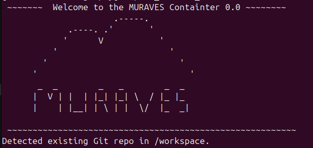

MURAVES environment
===

:blue_book: *Standardizing the software is essential for reproducible analyses, and containers make
this possible. This page explains how to set up your workspace to run the MURAVES scripts.*\
**Maintainer:** Alice Biolchini (alice.biolchini@uclouvain.be). Please report any problems you find.

The *muraves-env* container is used to analyse MURAVES data. A container can be thought of as a
snapshot of a virtual machine: whatever changes are made while using it, it always starts from the
same initial state. Local folders can be connected ("mounted") to the container: changes made inside
these folders are persistent and visible outside the container as well. This lets you develop
scripts without losing your work, while using a standard, consistent set of software and packages.

The container provides ROOT, Python 3.11, Snakemake and Jupyter. Python comes with numpy, pandas,
polars, matplotlib, scipy, iminuit, zfit and uproot. The `muraves_lib` package of this repository is
installed (in editable mode) every time the container starts.

# Starterkit

*New to MURAVES? Start here.*

### Step-by-step: set up your workspace on T2B

1. Connect to T2B (the computing cluster of VUB). See the
   [data access instructions](../documentation/README.md#data-access).
2. Download the latest version of `setup_muraves.sh`:
   ```bash
   wget https://raw.githubusercontent.com/muraves/Software/refs/heads/master/environment/docker/setup_muraves.sh
   ```
3. Make it executable: `chmod +x setup_muraves.sh`
4. Run it: `./setup_muraves.sh`. It asks for your workspace folder (default: your home directory).
5. If it succeeded, congratulations! The container is running and you should see:



The script:
- clones the MURAVES repository into `<workspace>/Software`, if it is not there yet;
- starts the image `/group/Muography/MURAVES/container/muraves-env.sif`, which activates the
  `muraves` environment and installs `muraves_lib`;
- mounts these folders inside the container:

| On T2B | In the container |
|---|---|
| `<workspace>` | `/workspace` |
| `/pnfs/iihe/muraves/muraves_DATA` | `/data` |
| `/group/Muography/MURAVES/` | `/outputs` |

Run `./setup_muraves.sh` again every time you want to open the container.

**NB: using a container is like using another laptop that has only a few folders in common with T2B:**
  - You can pull and push from Git.
  - Changes to the files in the mounted folders (your scripts) are persistent.

  BUT:
  - Changes to the software installed in the container (new conda environments, new Python
    packages, new libraries, etc.) are temporary and exist only during the current session.

### Editor: Visual Studio Code
The choice of editor is personal. However, it can be handy to ssh to T2B directly from your
editor and open the scripts as if you were working on your laptop. VSCode is useful for this: its
Remote-SSH extension, provided by Microsoft, lets you tunnel directly to T2B.

### Run Jupyter notebooks (.ipynb files)
Running Jupyter notebooks inside the container requires a couple more steps:
1. Start a Jupyter server from inside the container:
   `jupyter notebook --no-browser --ip=0.0.0.0 --port=8888`. Keep it running to maintain the
   connection.
2. In the output you should see a URL like
   `http://127.0.0.1:8888/tree?token=6324779336imafakeurljusttoshowyou72`.
3. You now have two choices:
   - (a) Copy and paste the URL into your browser and run the notebook from there.
   - (b) Use VSCode:
     - Open the notebook.
     - Click on the kernel at the top right.
     - Click 'Select another kernel', then 'Existing Jupyter Server'.
     - Paste the URL and press enter.
     - Select a kernel among those available in the container (e.g. Python 3 (ipykernel)).
     - The first run may take some time to connect to the kernel; that's normal.

### Next steps
- Learn about the detector and the data: [documentation/README.md](../documentation/README.md)
- Run the reconstruction pipeline:
  [muraves/tracks_reconstruction/README.md](../muraves/tracks_reconstruction/README.md)

# Local installation (Docker)

You are free to set up your preferred environment locally. One option is to build the same
container: the `Dockerfile` and `entrypoint.sh` are in [`environment/docker/`](docker/).

1. Get the repository: `git clone https://github.com/muraves/Software.git`, or, if you already
   have it, run `git pull` from the `Software` directory.
2. Build the image:
   ```bash
   cd Software/environment/docker/
   docker build -t muraves-env .
   ```
3. Run the image, mounting the folder that contains `Software`:
   ```bash
   docker run -it -v <my/local/folder>:/workspace muraves-env
   ```
   Everything in `<my/local/folder>` is available in the container under `/workspace`, and the
   changes you make there persist after the container is closed.

# Without a container: mamba environment

If you prefer not to use a container, you can create a conda environment.

### Install Miniforge
Install [Miniforge](https://github.com/conda-forge/miniforge). It provides `mamba`, which is faster
than `conda`. Anaconda or Miniconda also work: replace `mamba` with `conda` in the commands below.

* Download the installer for your OS, e.g. for Linux
  [Miniforge3-Linux-x86_64.sh](https://github.com/conda-forge/miniforge/releases/latest/download/Miniforge3-Linux-x86_64.sh).
* Run `bash Miniforge3-Linux-x86_64.sh` and follow the instructions. Install it in a place with
  enough disk space (on T2B, better not in your home directory).
* When asked whether to activate it, answer yes, so that you can use `mamba` directly.
* Close and reopen the terminal (or source your `~/.bashrc`) for the changes to take effect.

### Create the environment
```bash
mamba create -n muraves -c conda-forge -c bioconda python=3.11 root iminuit uv pandas polars numpy scipy matplotlib jupyter zfit snakemake uproot
mamba activate muraves
```
These are the same packages as in the container (see the [`Dockerfile`](docker/Dockerfile)). Then,
from the `Software` directory, install `muraves_lib`: `pip install -e .`

# For maintainers: update the container on T2B

T2B does not support Docker, so the image is built locally and converted with Singularity.

1. Apply the changes to the `Dockerfile` and build the image locally, as in
   [Local installation](#local-installation-docker).
2. Save the image as a `.tar` file:
   ```bash
   docker save muraves-env:latest -o muraves-env.tar
   ```
3. Copy the tar file to T2B. It is ~6 GB, so better use rsync:
   ```bash
   rsync -avP muraves-env.tar <username>@mlong.iihe.ac.be:/group/Muography/MURAVES/container/.
   ```
4. Log in to T2B and build the Singularity image:
   ```bash
   cd /group/Muography/MURAVES/container/
   singularity build muraves-env.sif docker-archive://muraves-env.tar
   ```

Running the image directly with `singularity shell` does not run `entrypoint.sh`, so the
environment is not activated. This is why users start it through `setup_muraves.sh`, which calls
`entrypoint.sh`.

The pipeline jobs on HTCondor use a different image, built from
[`condor_submit/container/muraves-sing.def`](../condor_submit/container/muraves-sing.def) and stored
next to this one in `/group/Muography/MURAVES/container/`; see the
[HTCondor README](../condor_submit/README.md#the-container-image).

# Troubleshooting

### Error importing zfit
If the error looks like `ImportError: /lib64/libstdc++.so.6: version 'GLIBCXX_3.4.20' not found`,
give the path to the library of your environment:
* Check that `libstdc++.so.6` is in your environment: `ls <mypath>/miniforge3/envs/muraves/lib/`
* If it is there, run:
  ```bash
  export LD_LIBRARY_PATH=<mypath>/miniforge3/envs/muraves/lib/:$LD_LIBRARY_PATH
  ```
  You can add this line to your `~/.bashrc`, so that it runs in every new terminal.
* If it is not there, search for it and use its path instead.
